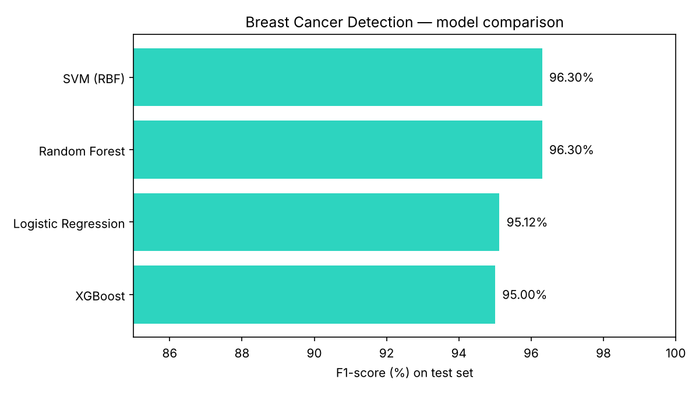

# 🩺 Breast Cancer Detection with Machine Learning

Classifying breast tumors as **malignant** or **benign** using the Breast Cancer Wisconsin (Diagnostic) dataset, comparing four classic ML models.



## 📂 Dataset
- **Source:** Breast Cancer Wisconsin (Diagnostic), loaded via `sklearn.datasets.load_breast_cancer`
- **Samples:** 569 (212 malignant, 357 benign)
- **Features:** 30 numeric features computed from cell nuclei images (radius, texture, perimeter, area, smoothness, concavity, …)

## ⚙️ Approach
1. Load and explore the data with Pandas
2. Stratified 80/20 train-test split
3. Feature scaling with `StandardScaler` (for Logistic Regression and SVM)
4. Train 4 models: Logistic Regression, Random Forest, SVM (RBF), XGBoost
5. 5-fold stratified cross-validation on the training set
6. Evaluate on the unseen test set (114 samples)

## 📊 Results (test set)

| Model | CV Accuracy | Accuracy | Precision | Recall | F1 | ROC-AUC |
|---|---|---|---|---|---|---|
| **SVM (RBF)** | 97.14% | **97.37%** | **100%** | 92.86% | **96.30%** | 0.9947 |
| Random Forest | 96.04% | 97.37% | 100% | 92.86% | 96.30% | 0.9944 |
| Logistic Regression | 97.36% | 96.49% | 97.50% | 92.86% | 95.12% | 0.9960 |
| XGBoost | 97.14% | 96.49% | 100% | 90.48% | 95.00% | 0.9937 |

**Best model, SVM, confusion matrix:** 39 malignant caught, 3 missed, 0 false alarms, 72 benign correctly cleared.

## 🔍 Top 5 features (Random Forest importance)
1. Worst perimeter (14.3%)
2. Worst area (14.2%)
3. Worst concave points (11.3%)
4. Mean concave points (8.9%)
5. Worst radius (8.3%)

## 💡 Key learning
In medical AI, accuracy alone is not enough. **Recall** matters most, since a missed malignant case is far costlier than a false alarm. Next step: tune the decision threshold to push recall higher.

## 🚀 Run it
```bash
pip install -r requirements.txt
python breast_cancer_ml.py
```
Outputs: `results.csv`, `results.json`, `model_comparison.png`

## 🛠️ Tech stack
Python · Pandas · NumPy · Scikit-learn · XGBoost · Matplotlib

## 👤 Author
**Muhammad Awais**, AI Engineer | Machine Learning
[LinkedIn](https://www.linkedin.com/in/muhammad-awais-350b11246)
